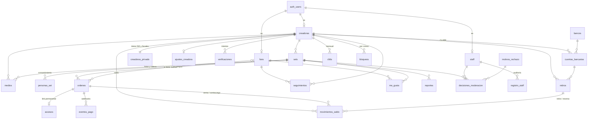

# Esquema de base de datos de Veloo

Migraciones en `migrations/`, en orden. Cada una cubre un área:

| Archivo | Área | Pantallas |
|---|---|---|
| `…100_base` | Utilidades (CLABE, correos, enmascarar) y personal interno | Panel |
| `…200_cuentas` | Creadoras, datos privados, ajustes, fans, push | C1b, C8, C9, L3, P3 |
| `…300_verificacion` | Intentos de verificación de identidad | C2, C2b, C2c, A2 |
| `…400_contenido` | Sets, medios, consentimiento de otras personas | C3, C4, C4b, C4v, E4, E5 |
| `…500_compras` | Órdenes, accesos, eventos del procesador | F4–F7, S4, E2, E3 |
| `…600_dinero` | Saldo, CLABE, retiros, CFDI | C6, C7, C10, C11 |
| `…700_social` | Seguir, me gusta, bloqueos | S1–S3, C11 |
| `…800_moderacion` | Decisiones, motivos, reportes | A1, A4, R1 |
| `…900_storage` | Buckets | — |
| `20261007…100_permisos_funciones` | Quita EXECUTE a funciones de trigger y a `es_staff()` para anon (advisor de Supabase) | — |
| `20261007…200_slug_y_motivos` | `sets.slug` (link `[usuario].veloo.vip/[slug]`, fijo aunque cambie el título) y los 5 motivos de rechazo | C5, F3, A1, E4 |
| `20261007…300_slug_default` | Default de `slug` para que el cliente no tenga que mandarlo (lo pone el trigger) | — |
| `20261007…400_motivos_reporte` | Motivos de R1 que faltaban: `contenido_robado` y `datos_personales` | R1, A4 |

## Diagrama

## Reglas que cumple la base de datos

No dependen del front: aunque alguien llame a la API directo, la base las hace cumplir.

**Contenido**
- La creadora no cambia el estado de un set directo. Lo cambia solo con `enviar_a_moderacion()` y `retirar_set()`.
- No se envía a moderación sin la declaración ni sin las firmas de todas las personas que aparecen (C4b).
- Si alguien retira su firma, el set se oculta solo.
- Un reporte por "Aparezco sin haberlo aceptado" o "Puede ser menor de edad" oculta el set de inmediato (R1).
- Un set no se aprueba si la creadora no está verificada o si falta alguna firma (A1).

**Dinero**
- El saldo es la suma de `movimientos_saldo`, no un número que se sobrescribe.
- Cada venta queda retenida 7 días. Un contracargo descuenta el neto y revoca el acceso.
- Para retirar se necesitan: verificación aprobada, mínimo $200, CLABE activa y saldo suficiente. Un retiro a la vez por creadora.
- La CLABE se valida con su dígito de control y un banco reconocido. Al cambiarla, los retiros se pausan 24 h.
- `confirmar_pago()` es idempotente: si el webhook llega dos veces, el pago no se cuenta doble.

**Cuentas**
- El subdominio solo se cambia cada 90 días, y hay nombres reservados (`www`, `admin`, `app`…).
- La creadora no puede marcarse como verificada a sí misma.

## Qué ve cada quien

| Quién | Lee directo | Lee por vista (enmascarado) |
|---|---|---|
| Cualquiera (anon) | Perfiles verificados, sets publicados y sus medios, bancos | `contadores_creadora`, `contadores_set` |
| Creadora | Su perfil, sus sets, medios, retiros, movimientos y CFDI | `mis_ventas` (correo `f•••@`), `mi_saldo`, `mi_cuenta_bancaria` (`•••• 5678`), `personas_de_mis_sets` (teléfono `••• 5678`), `mis_bloqueos` |
| Fan | Su cuenta, a quién sigue, sus me gusta | `mis_compras` (por cuenta o por el correo con el que entró) |
| Staff | Sets, medios, verificaciones, reportes y decisiones | — |
| Servidor (secret key) | Todo | — |

Las órdenes, accesos, CLABEs completas, datos de INE y reportes **nunca** se leen desde el navegador.

## Funciones que solo llama el servidor

`confirmar_pago`, `registrar_contracargo`, `vencer_ordenes` (cron), `activar_cuenta_bancaria`, `revertir_retiro`, `moderar_set`, `resolver_reporte` y `esta_bloqueado`.

## Pendiente de decidir

- **Catálogo de bancos:** está parcial (15 bancos). Hay que completarlo con el catálogo SPEI de Banxico.
- **Motivos de rechazo:** la tabla `motivos_rechazo` está vacía. El texto exacto que leerá la creadora lo tiene que escribir quien modere.
- **Comentarios:** el feed S1 muestra "Comentar", pero el diseño no define cómo funcionan. No hay tabla todavía.
- **Video de 4 GB:** el plan gratis de Supabase limita cada archivo a 50 MB. Para video hace falta el plan Pro y subida por partes (TUS).
- **Cron:** `vencer_ordenes()` se programa con `pg_cron` (Supabase → Integrations → Cron), cada 5 minutos.
